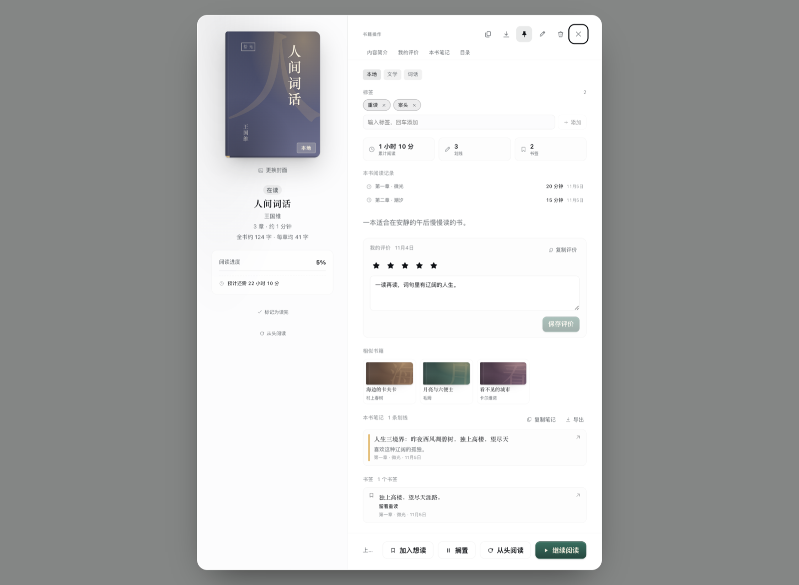
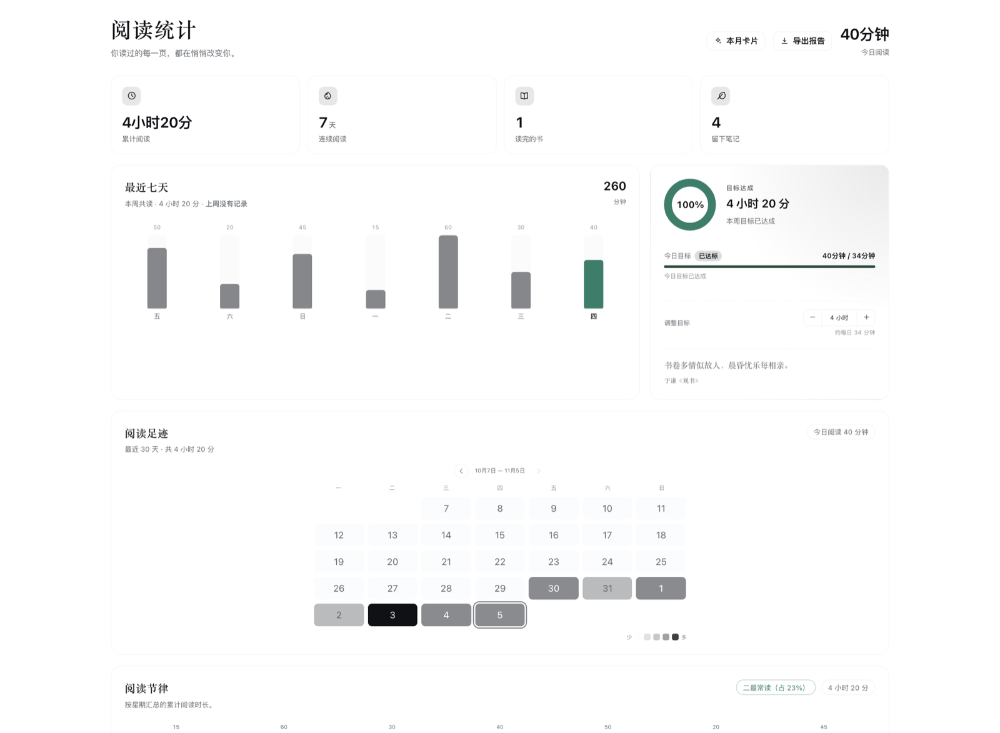

# 拾光阅读 · Shiguang Reader

[](https://www.npmjs.com/package/shiguang-reader)
[](https://github.com/sayhia/shiguang-reader/actions/workflows/publish.yml)
[](LICENSE)

> 把世界关小一点，把书页放大一点。

装进 DeepSeek Harness 的本地阅读器：书架、沉浸式阅读、划线想法、书签、搜索和统计，都在同一个安静的面板里。

## 界面

| 书架 | 批量操作 |
|:---:|:---:|
|  |  |
| **书籍详情** | **阅读统计** |
|  |  |

<sub>截图由真实 React 组件与生产 CSS 在无头 Chromium 中渲染，使用演示数据。</sub>

## 安装

### 在 Harness 中安装

打开 **设置 → 插件**，安装 Bundle：

```text
shiguang-reader
```

也可以跟随 GitHub 最新提交：

```text
github:sayhia/shiguang-reader
```

安装后刷新 Web UI，点击左侧栏的书本图标「拾光阅读」。

### 直接安装 npm 包

```bash
npm install shiguang-reader
```

- npm：<https://www.npmjs.com/package/shiguang-reader>
- GitHub：<https://github.com/sayhia/shiguang-reader>

### 第一次使用

1. 点击「导入本地书」，选择 TXT / Markdown / EPUB / MOBI / AZW3 / FB2（可多选，也可直接拖入）。
2. 首次导入会被要求选择一个**书库目录**；正文和原始 EPUB 都会保存在那里。
3. 开始阅读、划线、写想法，数据自动保存。

## 功能

### 阅读
分页阅读、目录与章节进度、纸张/烛光/雪白/夜间/墨水屏/跟随系统主题、字号/行距/四档页宽与自定义页宽调节、全屏与语音朗读。

### 笔记
划线、想法、四种颜色、标签、书签、书评、摘录卡片；支持导出 Markdown、Obsidian Callout 与整本笔记。

### 书架
封面/列表/分组视图，按最近阅读、进度、评分、字数排序；置顶、想读、搁置、已读完；多选批量操作。

### 搜索与统计
书内搜索、跨书正文搜索、命中高亮、引用复制；七日趋势、连续阅读、热力图、阅读节律、时长排行与月度卡片。

### 阅读布局
单页 / 双栏 / 连续滚动；精装、杂志、极简三套预设；设置支持全局 / 仅本书范围、搜索、实时预览、撤销/重做与首次引导；沉浸式工具栏、书级封面、章节扉页、章节进度轨、页边批注与脚注、专注阅读带、竖排、按书图片布局、左侧停靠侧栏、极简底栏、拇指底栏和边缘翻页。

## 数据

- 正文只保存在你选择的**书库目录**：`library.json` + `books/*.txt` + 原始 `.epub`。
- MOBI / AZW3 / FB2 导入时转换为可读的 `books/*.txt` 正文，图片放在同名 `.assets/` 目录；不另存原始文件。
- 浏览器只保存书架元数据、进度、笔记与设置。
- SQLite 只做宿主侧的**派生检索索引**，可随时删除重建；设置 `index: false` 可完全关闭。
- 不使用 `better-sqlite3`，SQLite 也不是主存储。

## 宿主工具

| 工具 | 用途 |
|---|---|
| `reading_search` | 跨书全文检索 |
| `reading_book_read` | 读取目录和章节正文 |
| `reading_notes` | 查询划线、想法与标签 |
| `reading_bookmarks` | 查询书签与备注 |
| `reading_shelf` | 查询书架、状态、评分与进度 |
| `reading_stats` | 阅读统计、时长排行与目标 |
| `reading_library_config` | 记住书库目录、查看索引状态 |

## 开发

```bash
npm run dev     # 监听 source/，自动构建
npm run build   # 手动构建
npm test        # 客户端 + 宿主测试
```

客户端源码在 `source/`，构建产物为 `client.js` 与 `parse-worker.js`。

本地开发也可以直接链接源码目录：

```bash
dsh plugin --profile desktop add link:/path/to/shiguang-reader
```

推送 `main` 时，GitHub Actions 只会构建和跑测试，不会发布 npm。需要发布时，先更新版本并推送，再在 Actions 中手动运行 **Publish npm package**。

```bash
npm version patch
git push origin main
```

## 已知边界

- 书库目录依赖 Chromium 的 File System Access API；Safari / Firefox 不支持导入。
- EPUB 按纯文字阅读，不还原固定版式；不解析 PDF。
- 支持的格式：TXT、Markdown、EPUB、MOBI / AZW / AZW3 / PRC（PalmDOC 与 HUFF/CDIC 压缩）、FB2 / FBZ。
- 受 DRM 保护的 Kindle 书与 Topaz 格式无法导入；PDF、DOCX、HTML、RTF 暂不支持。
- 没有标题标签的 MOBI 按「第 N 章 / Chapter N」等行分章。
- 截图使用演示数据，真实阅读数据保存在本机。

## 许可证 · License

本项目基于 [Apache License 2.0](LICENSE) 许可协议开源。
